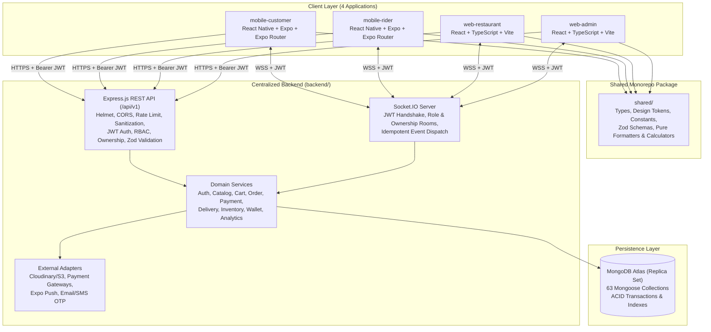

# 01. System Architecture

## 1. Executive Summary

The **Food Ordering & Delivery Platform** (brand identity: **ZestRoute**, established in Phase 2) is a commercial-grade, multi-restaurant, multi-city food ordering and delivery ecosystem serving four distinct user roles through four dedicated client applications backed by a single centralized **Node.js + Express.js + Socket.IO + MongoDB Atlas (Mongoose)** backend.

### Core Architectural Principles
1. **UI/UX First**: Every screen is designed and built with a unified design system (`#F47B20` Orange primary, `#FFF9F2` Warm Cream canvas, Inter + Noto Sans Arabic typography, Light/Dark modes, English + Urdu RTL support) before complex backend wiring.
2. **Zero Direct Client Database Access**: None of the four client apps ever connect to MongoDB directly. All reads, mutations, uploads, and real-time subscriptions go through authenticated, RBAC-protected Express.js REST endpoints and Socket.IO gateways.
3. **Single Source of Truth**: MongoDB Atlas (with Replica Set enabled for multi-document ACID transactions) is the sole primary database across all 63 collections.
4. **Server-Side Authority**: All prices, discounts, taxes, commissions, stock deductions, wallet balances, and payment verifications are computed and enforced server-side.
5. **Strict Financial Precision**: Monetary values are stored as integer minor units (`paisa`, where `Rs. 1.00 = 100 paisa`) paired with an explicit `currency` code (`PKR` default). Floating-point arithmetic is prohibited for money.

---

## 2. High-Level System Topology

---

## 3. Application Interfaces & Module Ownership (All 60 Modules)

| App | Technology | Target Users | Modules Owned |
|---|---|---|---|
| **Customer Mobile** (`mobile-customer/`) | React Native, Expo, TypeScript, Expo Router | Customers | Modules 1–21 (Core), Modules 54–60 (Advanced: AI Recommendations, Group Orders, Scheduled, Recurring, Membership/Loyalty, Surprise Box, Ramadan/Festival) |
| **Rider Mobile** (`mobile-rider/`) | React Native, Expo, TypeScript, Expo Router | Delivery Riders | Modules 35–40 (Registration, Dashboard, Delivery Requests, Pickup, Delivery + OTP/Proof, Earnings) |
| **Restaurant Dashboard** (`web-restaurant/`) | React, TypeScript, Vite, Responsive CSS | Restaurant Owners & Authorized Staff | Modules 22–34 (Registration, Dashboard, Profile, Branches, Categories, Products, Customizations, Orders, Inventory/Recipes, Staff/Permissions, Promotions, Reviews, Financials) |
| **Super Admin Dashboard** (`web-admin/`) | React, TypeScript, Vite, Responsive CSS | Super Administrators | Modules 41–53 (Dashboard, Customers, Restaurants/Apps, Riders/Apps, Global Orders, Global Categories, Coupons, Banners, Commissions, Payments, Refunds/Disputes, Analytics/Exports, Platform Settings) |
| **Backend API** (`backend/`) | Node.js LTS, Express.js, Mongoose, Socket.IO, Zod | All 4 Clients + Webhooks | All 60 modules' business logic, 63 collections, RBAC, real-time events, payments, media, notifications |

---

## 4. Technology Stack & Library Selection

### Backend (`backend/`)
- **Runtime & Framework**: Node.js (v24 LTS), Express.js
- **Database & ODM**: MongoDB Atlas + Mongoose
- **Validation**: Zod (request body, query, params, and shared contracts)
- **Auth & Security**: `jsonwebtoken` (short-lived JWT access + rotating hashed refresh tokens), `argon2` or `bcryptjs` (password & OTP hashing), `helmet`, `cors`, `express-rate-limit`, `express-mongo-sanitize` (NoSQL injection protection)
- **Real-Time**: `socket.io`
- **Media**: `cloudinary` (primary) / `@aws-sdk/client-s3` (S3-compatible adapter) + `multer` (memory/stream validation)
- **Utilities**: `date-fns`, `pdfkit` or `exceljs` (server-side invoice/report exports)

### Mobile Apps (`mobile-customer/`, `mobile-rider/`)
- **Core**: React Native, Expo (SDK 52+), TypeScript, Expo Router
- **State**: `zustand` (UI/cart/session state) + `@tanstack/react-query` (server state, caching, pagination, optimistic UI where safe)
- **Forms & Validation**: `react-hook-form` + `@hookform/resolvers` + `zod`
- **Native Capabilities**: `expo-notifications`, `react-native-maps`, `expo-location`, `expo-image-picker`, `expo-image`, `@react-native-async-storage/async-storage`, `@react-native-community/netinfo`, `expo-secure-store` (token storage)
- **Real-Time & Dates**: `socket.io-client`, `date-fns`

### Web Dashboards (`web-restaurant/`, `web-admin/`)
- **Core**: React, TypeScript, Vite, `react-router-dom`
- **State**: `zustand` + `@tanstack/react-query`
- **Forms & Validation**: `react-hook-form` + `@hookform/resolvers` + `zod`
- **Charts & Exports**: `recharts` (analytics), `jspdf` / `xlsx` (client export helpers paired with backend reports)
- **Real-Time & Dates**: `socket.io-client`, `date-fns`, `lucide-react` (consistent iconography)

---

## 5. Mandatory Business Rules (Section 15) Enforcement Map

| # | Business Rule | Enforcement Mechanism |
|---|---|---|
| 1 | Only approved restaurants accept orders | `restaurants.status === 'approved'` checked in cart/checkout/order services |
| 2 | Only approved riders receive assignments | `riders.status === 'approved'` & `isOnline === true` checked in dispatch service |
| 3 | Closed restaurants cannot receive immediate orders | Branch `restaurant_hours` + `isTemporarilyClosed` validated in order service (scheduled orders validate target slot) |
| 4 | Unavailable food cannot be ordered | `food_items.isAvailable === true` & stock check in cart & checkout |
| 5 | All prices verified server-side | Checkout ignores client prices; reads `food_items`, `food_variants`, `food_addons` from MongoDB |
| 6 | Cart totals recalculated before checkout | `CartService.recalculate(cartId)` runs on every mutation & order creation |
| 7 | One active cart belongs to one restaurant | `carts.restaurantId` enforced; switching restaurant prompts confirmation & replaces cart |
| 8 | Orders have unique order numbers | Atomic sequence / formatted unique `orderNumber` with unique MongoDB index |
| 9 | Duplicate order submissions prevented | Required `Idempotency-Key` header + unique index on `(customerId, idempotencyKey)` |
| 10 | Online payments verified by provider | Server-side gateway API verification + signed webhook verification before `paid` |
| 11 | Rider cannot receive conflicting assignments | Atomic `findOneAndUpdate` on `delivery_assignments` + active-delivery check |
| 12 | Delivery completed with valid verification | Customer 4–6 digit `deliveryOtp` (hashed/verified server-side) + optional proof photo |
| 13 | Customers review only eligible completed orders | `orders.status === 'delivered'` & `orders.customerId === req.user.id` + unique `(orderId, customerId)` |
| 14 | Refunds follow configured policy | Policy rules in `app_settings`; `refunds` state machine audited |
| 15 | Wallet transactions recorded | Every credit/debit writes an immutable `wallet_transactions` ledger entry inside a MongoDB transaction |
| 16 | Financial transactions immutable | `payment_transactions`, `wallet_transactions`, `restaurant_payouts`, `rider_payouts` append-only |
| 17 | Every order status change recorded | `order_status_history` written atomically on every transition |
| 18 | Stock must not become negative | Atomic conditional decrement `{ quantity: { $gte: requiredQty } }` inside order transaction |
| 19 | Restaurant commission calculated consistently | Snapshot `commissionRateBps` (basis points) & `commissionAmount` stored on `orders` at creation |
| 20 | Personal info protected | Field-level projection & RBAC masks phone/CNIC/address when not authorized |
